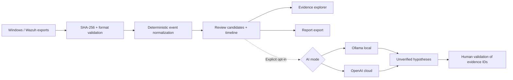

<div align="center">

# ◈ LLM-DFIR
### Evidence-aware digital forensics, with AI on your terms.

**A modern, local-first investigation workspace for Windows security logs and Wazuh alerts.**


**Offline triage** · **Evidence-linked findings** · **Incident timelines** · **Optional local/cloud AI**

> **Project maturity:** Functional educational prototype, not a validated forensic product.

</div>

---

## Why this project exists

Forensic analysts need a way to inspect security events without losing sight of **what the evidence actually says**. LLM-DFIR separates deterministic parsing and review candidates from optional AI-generated hypotheses.

The application is offline by default; AI is opt-in. Generated interpretations are never treated as verified forensic conclusions.

## Product experience

| 🧩 Evidence workspace | 🔍 Investigator workflow | ✦ Hybrid AI |
|---|---|---|
| Drag-and-drop JSON/JSONL/CSV intake | Event filtering and evidence IDs | Offline analysis by default |
| SHA-256 of original uploaded bytes | UTC-aware timeline | Local Ollama support |
| Clear demonstration mode | Sequence leads for analyst review | OpenAI API mode with disclosure |
| Markdown and JSON export | Candidate ATT&CK technique mapping | Source evidence must be verified |

### Investigation dashboard

- **Overview** — event counts, review candidates, host coverage, severity distribution and sequence leads.
- **Evidence explorer** — searchable timeline with event IDs, hostnames, usernames and exact normalized evidence IDs.
- **Casebook** — two documented, fictional Wazuh/Windows investigations with linked JSON fixtures.
- **AI copilot** — optional local or cloud explanation with explicit safeguards and no autonomous actions.
- **Reports & export** — source SHA-256, analyst notes, Markdown report and normalized JSON download.

The default dataset is **synthetic** so the demo works immediately without private logs, tokens or accounts. Two additional, reproducible **fictional case studies** demonstrate structured investigations and machine-generated triage reports, clearly marked as training examples.

### ✦ Investigation casebook (v1.2)

| Scenario | Dataset | What you can verify |
|---|---|---|
| [CASE-001: Account creation → group membership](cases/CASE-001-account-group-change.md) | [Wazuh-style JSON](samples/case_001_account_group_change.json) | SID-linked 4720→4732 review lead, subsequent 4624 and 4698 events |
| [CASE-002: Failed logons → successful logon](cases/CASE-002-authentication-review.md) | [Wazuh-style JSON](samples/case_002_authentication_review.json) | Same-host/account authentication correlation with source-IP caution |

**These records are invented for public demonstration.** They are not exported from a live environment and do not establish real incidents. See [how to collect and validate your own Wazuh lab evidence](docs/real-wazuh-workflow.md).

## Architecture



**Trust boundary:** Uploaded bytes remain in the local Streamlit process. Only after explicit selection and action will bounded, selected summaries be sent to an AI service. Cloud mode requires an authorization checkbox.

## Quick start

**Requirements:** Python 3.11+ and a computer capable of running Streamlit.

### Windows PowerShell

```powershell
py -m venv .venv
.venv\Scripts\Activate.ps1
python -m pip install -r requirements.txt
python -m streamlit run app/main.py
```

### macOS / Linux

```bash
python3 -m venv .venv
source .venv/bin/activate
python -m pip install -r requirements.txt
python -m streamlit run app/main.py
```

Open the local URL printed in your terminal. The workspace loads in **Synthetic demo** mode by default. To inspect an authorized working copy, switch to **Upload evidence**.

### Run automated tests

```bash
python -m unittest discover -s tests -v
```

## Working with AI

| Mode | Data transfer | Setup |
|---|---|---|
| **Offline** (default) | None | No model or key |
| **Ollama (local)** | Loopback host only | Start Ollama; `ollama pull llama3.2` |
| **OpenAI cloud** | Bounded event summaries sent to OpenAI API | Provide API key in the UI and explicitly authorize transfer |

**Data minimization:** AI receives at most 40 normalized records with only evidence ID, timestamp, event ID, host, finding, severity and candidate mapping. Source file bytes, usernames and descriptions are not included in the AI payload. **Hostnames and timestamps can still identify systems or people**; cloud mode is not suitable for confidential case material without the required approval.

**Do not commit API keys, source case files, client records or personal information to GitHub.** AI-generated hypotheses are not written into the deterministic report as verified findings.

## Detection coverage

| Event ID | Event meaning | Interpretation | ATT&CK candidate |
|---|---|---|---|
| 4625 | Failed Windows logon | Authentication review lead | T1110 *only with corroboration* |
| 4624 | Successful Windows logon | Context event | — |
| 4720 | Account created | Review authorization | T1136 |
| 4732 | Member added to security-enabled local group | Review access changes | T1098 |
| 4698 | Scheduled task created | Review persistence possibilities | T1053.005 |

Two cautious **sequence leads** are supported within 30 minutes: **4625→4624** (same host and account; no conflicting source IP) and **4720→4732** (same host and exact created-account SID ↔ added-member SID). Windows 4732 `targetUserName` identifies the **group**, not the member. These are review cues, not conclusions of malicious activity. Timestamps without verified timezone offsets are marked and excluded from sequence logic.

## Repository map

```text
LLM-Digital-Forensics-Assistant/
├── .github/workflows/tests.yml  # Test on new commits
├── .streamlit/config.toml       # Dark theme design tokens
├── app/
│   ├── core.py                  # Parsing, hashes, rules and reports
│   ├── llm.py                   # Optional Ollama / OpenAI integration
│   └── main.py                  # Modern Streamlit workspace
├── cases/                      # Two synthetic investigations + generated reports
├── scripts/build_casebook.py   # Reproduce case reports offline
├── docs/
│   ├── methodology.md           # Method and limitations
│   ├── real-wazuh-workflow.md   # Authorized lab collection workflow
│   ├── references.md           # Primary event-field documentation
│   └── security.md              # Privacy and trust boundaries
├── samples/
│   ├── synthetic_wazuh_alerts.json
│   ├── case_001_account_group_change.json
│   └── case_002_authentication_review.json
├── tests/
│   ├── test_core.py
│   └── test_casebook.py
├── README.md
├── CHANGELOG.md
├── CONTRIBUTING.md
├── LICENSE
└── requirements.txt
```

## Roadmap

- [x] Structured Wazuh / Windows JSON and CSV parsing
- [x] Evidence hashing and stable record references
- [x] UTC-aware timeline and filtered investigation explorer
- [x] Local/cloud AI integration and manual approval
- [x] Rule-based review candidates and simple sequence leads
- [x] Modern, responsive dark-mode interface
- [x] Reproducible synthetic Wazuh casebook and deterministic reports
- [ ] Native EVTX support with appropriate parsing validation
- [ ] Expanded rules with test fixtures and benchmark measurements
- [ ] Corroboration-based evidence citations for AI output
- [ ] PDF report export and investigator case management
- [ ] Threat-model review and deployment hardening

## Reproducing case studies

```bash
python scripts/build_casebook.py
python -m unittest discover -s tests -v
```

The generated Markdown reports in `cases/generated/` include the SHA-256 digest of each exact sample fixture. The fixtures contain only fictional events.

For **actual Wazuh screenshots and alerts**, follow [this authorized lab workflow](docs/real-wazuh-workflow.md). Keep raw exports private and validate that the agent received the events; don't represent synthetic casebook files as live results.

## Reproducibility and limitations

Read the [methodology](docs/methodology.md) and [security notes](docs/security.md) before operational use. This prototype does **not** implement full chain of custody, immutable evidence storage, access control, comprehensive Windows event coverage, or legally validated forensic interpretations. Streamlit should be run only in a trusted local development environment. AI can hallucinate, including bogus references, and requires human review.

## License

MIT — see [LICENSE](LICENSE). Use only authorized and lawfully obtained evidence.
